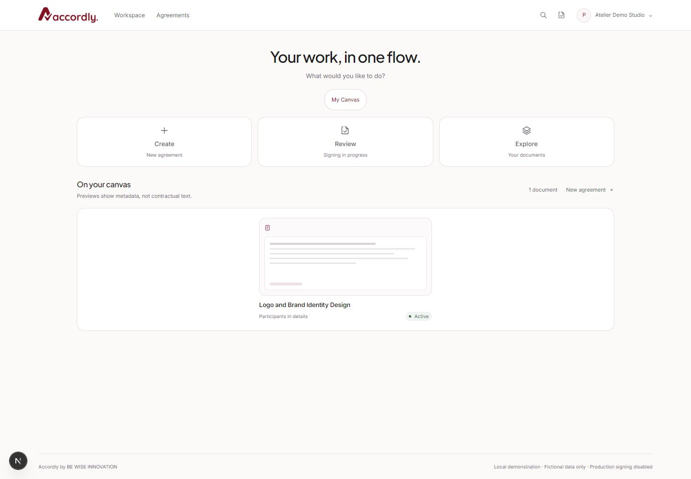
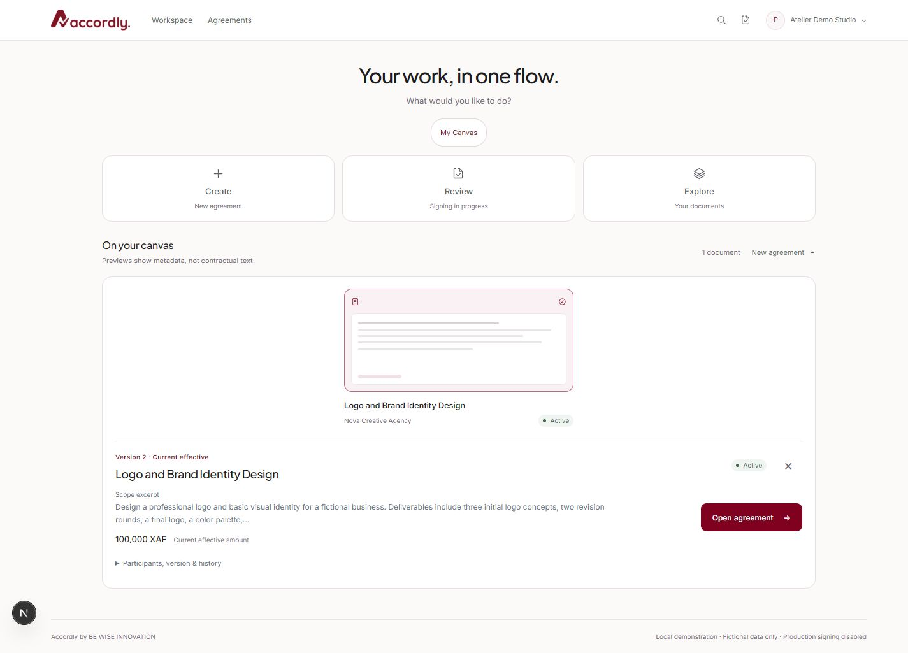
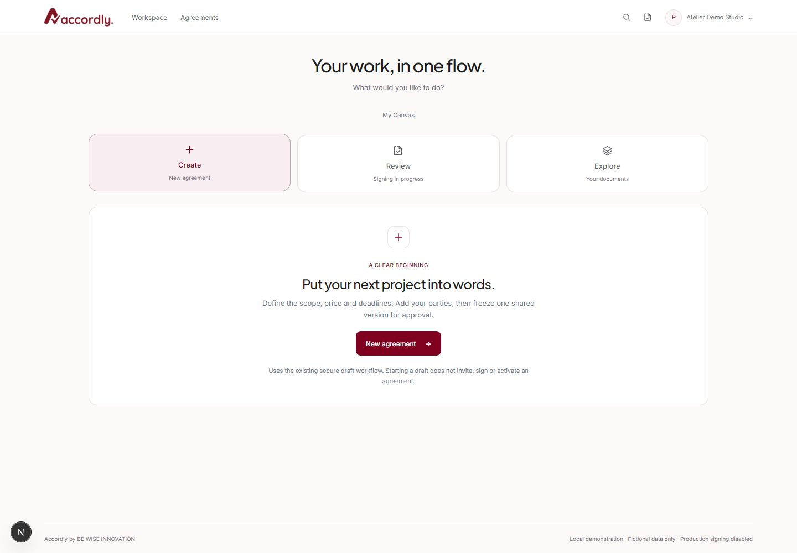
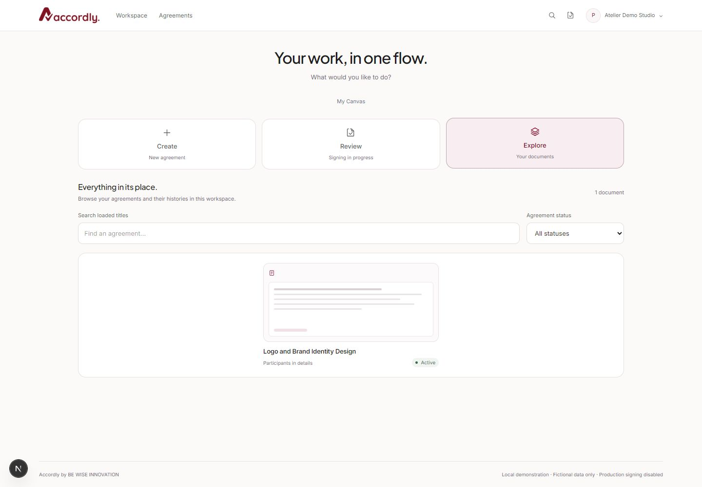
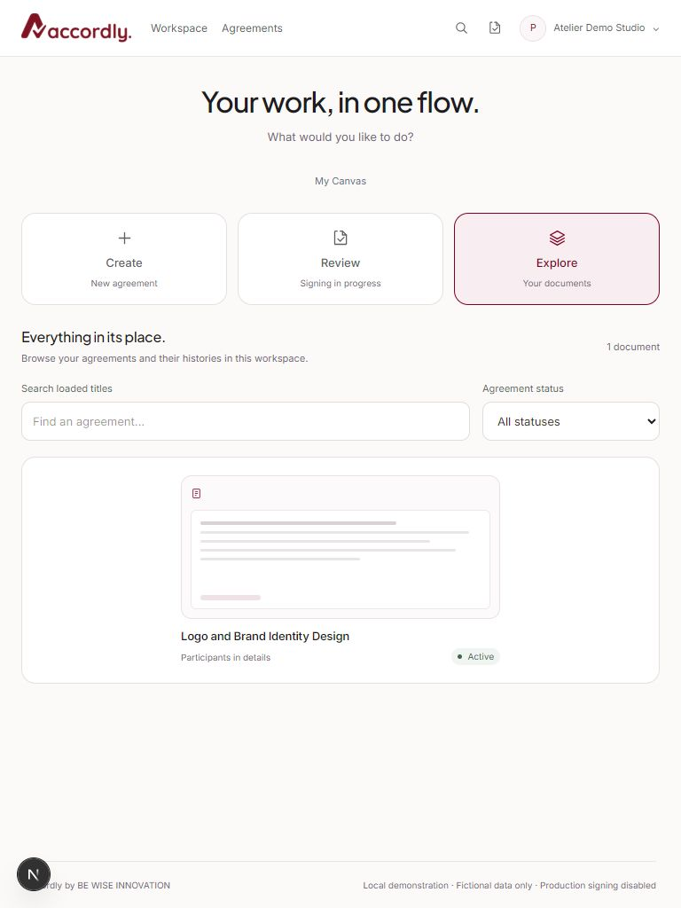
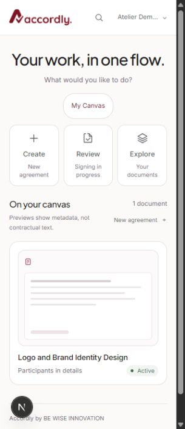
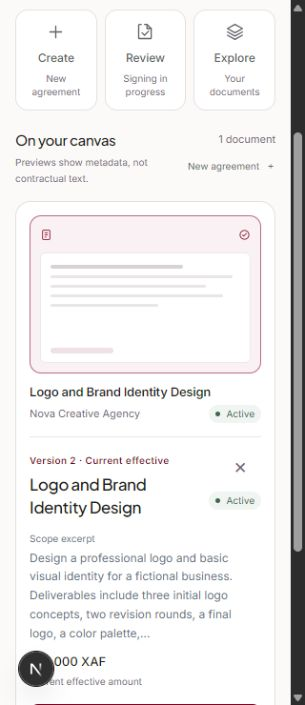

# Stage 3B.1 — FlowCanvas visual refinement

Date: 13 November 2026. Scope: presentation and interaction refinements to `/app` only.

## Result and design decisions

The supplied references guided the centered introduction, three action tiles, landscape document artifacts and supporting detail strip. This is an original implementation using the existing official Accordly logo. White and warm-white surfaces dominate; burgundy highlights selected controls and primary actions. No dependencies, graphic assets from other products, or animation libraries were added.

- Compact header with Workspace/Agreements navigation, working search and review shortcuts, and the existing workspace/account disclosure. There is no invented notification feed. The header measures 64px on tablet and 61px at 320px viewport width. A scoped `margin-top: 0` fixes an inherited global `details` margin that had inflated the header.
- Centered “Your work, in one flow.” introduction. Create, Review and Explore are accessible action-card tabs; My Canvas remains a quieter fourth tab. Existing mode URLs, history behavior, deep links, arrow/Home/End keyboard navigation and workflow destinations remain intact.
- Landscape document previews with subtle paper structure, actual titles and actual lifecycle badges. Decorative rules are hidden from assistive technology and represent a preview, not contractual clauses. The check icon means selection, not approval or signature.
- A three/two/one-column responsive gallery. One or two loaded records are centered on larger screens instead of stretching or adding fictional filler documents. Existing six-item Canvas and incremental Explore limits remain.
- A restrained selected outline and tint. The summary sits below the gallery, with the authorized current version, status, a labeled scope excerpt, exact amount and existing permission-aware agreement link. Scope excerpts use at most 180 Unicode codepoints and an ellipsis; they do not replace the full agreement.
- Participants, version facts, historical frozen versions and refresh remain available in an expandable disclosure. Escape/Close preserve focus restoration. On mobile the existing stacked region focuses and scrolls into view.
- Brief hover/border feedback with reduced-motion overrides. The interface does not depend on motion to convey selection or status.

## Data and security boundaries

No backend, API contract, migration, auth, onboarding, signing, amendment, RLS, ownership or production-gate changes were made. The existing server workspace selection and repeated client organization filter remain.

The lightweight listing does not include participants or versions. Only the selected preview can display its actual client name after the existing authorized, no-store detail request succeeds and its agreement/organization response guards pass. A UI callback shares that result with the selected card; no additional requests or N+1 loading were introduced. Other cards say “Participants in details.” Selection metadata clears when a detail read starts, and is checked against both agreement and organization identifiers before rendering. Names are not inferred from email addresses.

Current effective terms continue to follow `effective_version_id`; the latest frozen candidate is not automatically effective. The retained fictional demo correctly displayed Version 2 / 100,000 XAF, with Version 1 preserved in history. The existing exact-money formatter was unchanged.

Review remains an explicitly limited workspace lifecycle view, not a personalized signing queue. It does not claim “Needs your signature.” Search is limited to loaded authorized titles; the inherited 200-row listing cap is disclosed when reached. No fake records, notifications, signatures or activity were inserted to match the references.

## Files changed

- `src/components/flowcanvas/workspace-frame.tsx` — compact header links/icons and introduction; account/auth behavior unchanged.
- `src/components/flowcanvas/canvas.tsx` — action tiles, gallery composition, selected metadata sharing, refined mode headings/counts and Create entry.
- `src/components/flowcanvas/document-preview.tsx` — landscape artifact, title/participant/status composition and selected treatment.
- `src/components/flowcanvas/detail-panel.tsx` — compact summary, labeled excerpt, expandable facts/history and optional guarded result callback.
- `src/components/flowcanvas/flowcanvas.css` — scoped visual system, header correction, responsive gallery, selected summary and reduced-motion styles.
- `src/components/flowcanvas/icons.tsx` — new small, decorative SVG line-icon component.
- `tests/flowcanvas-render.test.mjs` — load the actual icon component in the existing rendering harness.
- `scripts/account-integration.mjs` — update the expected workspace heading; existing access/empty-state assertions preserved.
- `docs/stage-3b1-report.md` — this report.
- Seven PNG browser captures under `docs/screenshots/stage-3b1/`, listed below.

## Validation actually executed

Commands used Node 24, satisfying the repository's Node >=22.18 requirement.

- `npm test`: **44 passed, 0 failed**. Includes FlowCanvas presentation/rendering, lifecycle/current-version semantics, exact money, tenant filtering, denied creation and existing security/input regressions.
- `npm run test:integration`: **268 assertions passed** against a task-owned disposable full local Supabase stack and a production Next.js server. Actual GoTrue sessions, PostgreSQL TLS, gateway authorization, account/workspace isolation, idempotency/concurrency/rollback and signing/amendment regressions ran. The stack was stopped by the runner afterward. This was not a mocked API test. The integration run preceded the final decorative Create SVG and CSS spacing/sparse-gallery adjustments; the subsequent application checks and final build covered those source changes.
- `npm run lint`: passed with zero warnings.
- `npm run typecheck`: passed.
- `npm run build`: passed, including a final run after the last CSS adjustment.
- Standalone `npm run test:db` was **not rerun in this visual-only stage**. The live integration runner applied migrations to its disposable database, but that is not presented as a fresh standalone SQL assertion-suite result.

Local command output is retained in ignored `.stage-3b1-*-validation.log` files. No remote or production database was modified; the retained local demo was not reset or reseeded.

### Browser acceptance

Used the real authenticated local provider demo at `localhost:3000` in the in-app browser, on the development server:

- Inspected desktop 1440×1000, tablet 768×1024 and narrow mobile 320×740. No horizontal overflow was observed; measured tablet page width equaled its 768px viewport. Mobile content measured 305px within the 320px viewport with the scrollbar.
- Verified all four modes, keyboard End/arrow switching, working header search navigation, actual title search yielding zero records, and Clear filters restoring the record.
- Selected the real fictional Logo and Brand Identity Design agreement. Its authorized detail read supplied Nova Creative Agency, Active, current effective Version 2 and 100,000 XAF. Expanded participants/history showed the preserved historical version. Close/Escape returned focus to the preview.
- Selected the document on mobile and verified the stacked, focused detail region and close behavior. Mobile action tiles remained touch-sized; the three tiles measured approximately 86×106px at 320px.
- Checked the Create entry and its existing `/app/agreements/new` destination without submitting a draft. The existing Open agreement destination was preserved. Review clearly disclosed its limited scope instead of claiming a personal signature requirement.
- The retained demo contains one accessible agreement. Multiple/draft/frozen collections, empty accounts and unrelated-account isolation were exercised through the real HTTP/server-rendering integration and component tests, not manually populated into this browser account. No retained agreement, invitation, signature or amendment was created or altered.

Production compilation and live production HTTP integration passed; a separate production-browser acceptance session was not run. Physical devices, screen-reader conformance, Safari/Firefox, deliberate network-failure/race injection and actual reduced-motion media emulation were not tested. Reduced-motion CSS was reviewed statically; this is not claimed as a dynamic media-emulation pass.

## Screenshots

Actual local fictional data only. Desktop/tablet captures show the page; mobile captures are viewport portions, including the scrolled selection region. No credentials, invitation tokens or verification codes are included.

## Local review and remaining limitations

Use the existing README local demo instructions and private fictional provider credentials. Open `/app`; no migration or setup reset is required. Select an agreement, expand its history, switch modes and try Explore filters. Mode changes and preview selection do not mutate contract data.

The existing listing cap, limited review queue and full-history detail response remain backend limitations. Participant names for unselected records require a future authorized preview projection; this refinement deliberately avoids extra fetching. Global notifications and profile/workspace administration are not implemented. Existing deployment blockers around approved legal content, verification delivery, abuse/rate limiting, recovery operations, audit retention and incident procedures remain. Production signing, registration and Google restrictions have not been enabled. No signature certification or legal enforceability is claimed.

Recommended next stage: review this visual refinement, then separately scope an authorized paginated preview projection and genuinely personalized review queue, followed by broader browser/assistive-technology acceptance. Agreement detail, guest signing and amendment interface redesign remains separate work.
