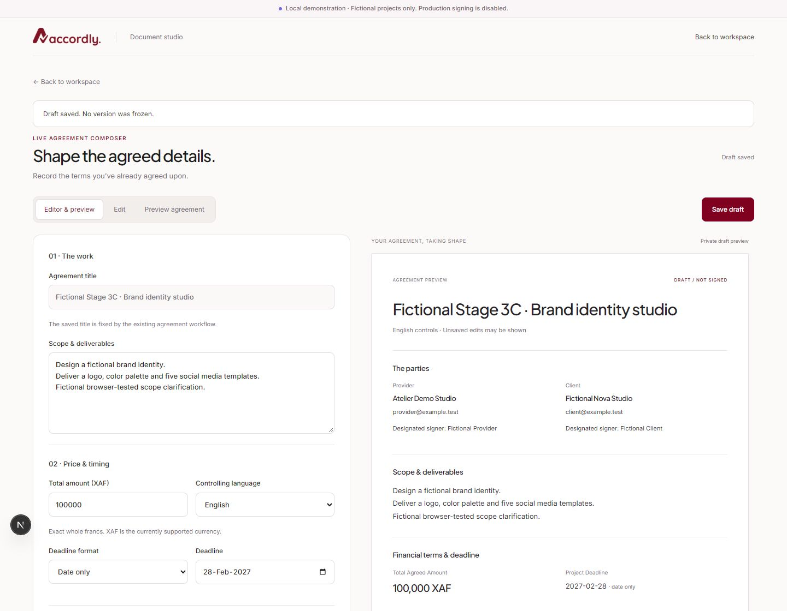
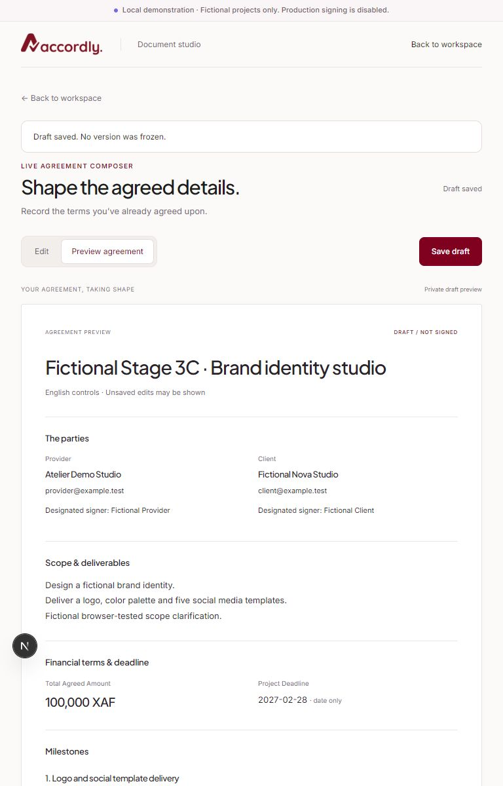
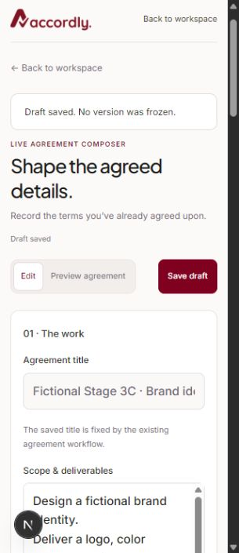
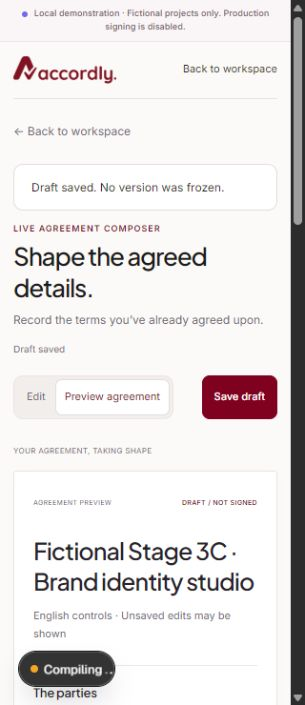
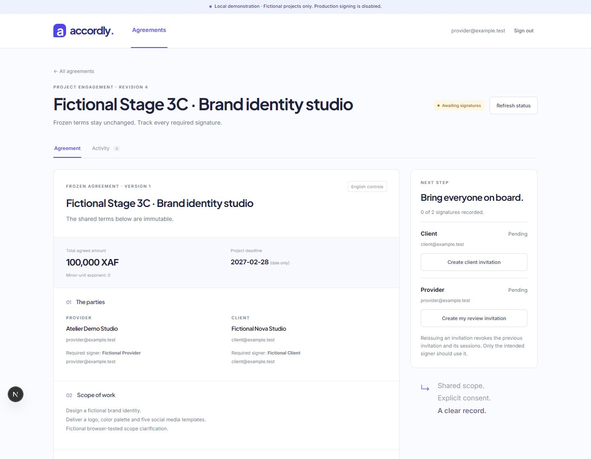

# Stage 3C — Live Agreement Composer

13 November 2026 · Local implementation and validation.

## Implemented experience

The existing `/app/agreements/new` and authorized editable-draft detail routes now open a document studio. Desktop has an editor and live unsigned document preview; either can be focused alone. Tablet and mobile use accessible Edit / Preview controls without unmounting or discarding the form state. The official logo, warm-white surfaces, subtle neutral borders and restrained burgundy actions follow Stage 3B.1. No dependencies were added.

The composer records arrangements already agreed outside Accordly. It does not introduce negotiation, proposal approval, new signing methods, generated legal clauses, PDFs or document distribution.

Supported fields map to the existing schema: title on creation, scope/deliverables, exact whole XAF amount, controlling English/French language, date-only or explicit UTC/timezone deadline, additional terms, and up to 50 optional milestones with deliverable, amount, deadline and acceptance terms. Milestones must allocate the total exactly. Separate payment arrangements belong in the existing terms field. There is no unsupported standalone deliverables field, currency selector or attachment uploader.

Terms are saved first using `create_draft`. The returned agreement route then supplies provider/client legal names, designated signer names and client mailbox through the existing `set_parties` command. Terms and parties remain explicitly separate saves; their atomicity has not been misrepresented. Existing drafts use `update_draft` and optimistic `expected_revision`. The saved title is read-only because the approved update command does not rename agreements.

The preview displays current input, including unsaved changes, without extra network requests. It includes parties, scope, exact financial terms, deadlines, milestones, additional terms and future signer placeholders. It is always labeled **DRAFT / NOT SIGNED**. Missing details are identified instead of invented. The preview is presentation only: no client-generated digest, version, legal clause, consent or signature becomes authoritative. The server still constructs and independently verifies the canonical frozen representation. Server identifiers, final consent disclosures, required signer bindings and canonical integrity details appear in the existing frozen review. The initial preparation model remains one designated provider signer and one designated client signer; richer representative editing is not implemented.

## Saving, navigation and freezing

- Save draft is explicit; no autosave or browser-storage persistence is claimed. Saved terms survive refresh via the authorized server read. Agreement content is not placed in localStorage/sessionStorage.
- Inline validation covers missing fields, exact money, calendar/timezone deadlines and milestone allocations; existing server Zod and SQL validation remain authoritative. Controls are disabled while the shared action is processing. The existing idempotency hook and persistent server receipts remain in use.
- Dirty terms or party fields show an unsaved state and disable freezing. Internal link navigation opens an accessible modal with Keep editing / Leave without saving. Refresh/tab closure retain the native `beforeunload` warning. Back/Forward interception is best-effort where the Navigation API exposes cancelable traversal; browsers cannot guarantee protection against process termination or unsupported traversal behavior.
- Freeze requires an initially unchecked affirmative review checkbox tied to the loaded revision, saved terms and saved parties. The existing `freeze` command performs authorization, revision/quorum checks and canonical construction. Freezing never signs, invites or activates. Success returns to the unchanged frozen detail and invitation/signing experience on the same agreement URL.
- FlowCanvas Create/New agreement links remain unchanged and reach the composer. No second write API or creation engine was introduced.

## Security boundaries

No migrations, RLS policies, role grants, server authorization, session handling, signing proofs, consent rules, immutable-version logic, amendment engine or production gates changed. Existing protected server layouts and detail projections remain responsible for access. There is no public preview endpoint. Text is rendered through React escaping rather than interpreted HTML. XAF uses integer strings and BigInt for validation/formatting, never floating-point conversion.

The existing amendment editor shares the old `DraftForm`; it was deliberately left unchanged. Active, frozen and read-only agreement screens retain their existing behavior. Composer styling applies only while the studio is present. Its compact official-logo header replaces the legacy header visually on composer pages, with a guarded return to the workspace; account controls remain in the workspace.

## Files changed

- New `src/components/composer/agreement-composer.tsx`: controlled terms/milestone editor, live panes, view controls, validation, save state and leave dialog.
- New `src/components/composer/document-preview.tsx`: reusable unsigned document presentation and exact deadline view.
- New `src/components/composer/model.ts`: presentation types, empty draft, exact XAF formatting, deadline and allocation feedback.
- New `src/components/composer/draft-studio.tsx`: authorized existing-draft party editor, existing command calls and explicit freeze gate.
- New `src/components/composer/studio-header.tsx`: official-logo document-studio navigation.
- New `src/components/composer/use-unsaved.ts`: dirty-navigation protection without synthetic history entries or private browser storage.
- New `src/components/composer/composer.css`: scoped responsive visual system, focus, modal and reduced-motion styles.
- `src/components/provider/new-agreement.tsx`: connect the existing create command and workspace selector to the composer.
- `src/components/provider/agreement-detail.tsx`: select the composer for editable preparation; return refreshed data after existing reads. Frozen/signing and amendment paths remain.
- New `tests/composer.test.mjs`: model/schema consistency, exact money/deadlines, empty states, escaped content and unsigned preview rendering.
- `scripts/provider-integration.mjs`: real protected new/edit composer rendering, unchecked freeze and unrelated-tenant page denial assertions.
- New `docs/stage-3c-report.md` and five actual PNG captures under `docs/screenshots/stage-3c/`.

## Checks actually executed

Used the repository-compatible Node 24 runtime. Local command outputs are retained in ignored `.stage-3c-*-validation.log` files.

- `npm test`: **48 passed, 0 failed**.
- `npm run test:db`: **275 SQL assertions passed** in an isolated disposable Supabase PostgreSQL container, plus restricted gateway login, retained-role migration replay and concurrent ownership/preparation/rate-counter/onboarding checks. The runner removed its own container and volumes.
- `npm run test:integration`: **272 real assertions passed**, including a final run after the leave-dialog change. The runner used its own disposable full local Supabase stack, live GoTrue, verified PostgreSQL TLS and production Next handlers; it stopped that stack afterward. Existing signing/amendment, account, tenant, idempotency, concurrency and rollback regressions were retained.
- `npm run lint`: passed with zero warnings.
- `npm run typecheck`: passed.
- `npm run build`: passed after the final implementation changes.

An initial integration assertion expected a cross-tenant page to always return HTTP 404. Next may stream the protected layout before `notFound()`, producing a 200 shell. The test was corrected to require the unavailable-page content and absence of both private terms and composer markup; API-level cross-tenant 404 checks remain. No authorization behavior was weakened to satisfy the test. An initial TypeScript check caught BigInt literal syntax under the configured target; the code now uses the supported BigInt constructor and checks passed on rerun.

## Browser acceptance actually performed

Used the real authenticated fictional provider demo at `localhost:3000`, with the development server. Production HTTP integration is separate from these browser checks.

1. Created **Fictional Stage 3C · Brand identity studio** through the actual UI and existing create command. Scope, terms, 100,000 XAF, 28 February 2027 deadline and a full-amount milestone appeared live.
2. Switched mobile Edit/Preview and verified field retention. Saved the draft; its returned ID was `87acec5e-c38b-4cd6-b9fd-6a40eeeb8866`. Refresh restored saved scope, amount, deadline and milestone.
3. Entered and saved fictional provider/client details through the existing party command. The preview displayed the actual fictional names and mailboxes.
4. Changed the total to 100,001 while its milestone remained 100,000. Saving was rejected by local allocation feedback and freeze stayed disabled. That inconsistent value was not persisted.
5. Edited the scope, triggered the final in-app leave dialog and chose Keep editing. The scope remained intact and was subsequently saved.
6. Reviewed the saved record, explicitly checked the freeze confirmation and froze it. The existing frozen screen showed Version 1, the saved scope clarification, milestone, deadline, 100,000 XAF, server digest, zero signatures and both original invitation actions. No invitation was issued and no signature was recorded for this test agreement.
7. FlowCanvas showed the new Awaiting signatures record alongside the original active amended agreement. Browser Back returned to the frozen record and Forward returned to the workspace; New agreement reached the original creation URL again. No duplicate was created by navigation.
8. Submitted an empty new form and observed required-field validation without creating a record. Triggered the final leave dialog again using an unsaved diagnostic title. The final **Leave without saving** button itself was not verified: the browser session disappeared after a user status interruption. Keep editing and saved-state Back/Forward were verified; this remaining discard branch is not reported as passed.

Checked desktop 1440×1000, tablet 768×1024 and mobile 320×740. Measured 753px content within the 768px viewport and 305px content within the 320px viewport with scrollbars, with no observed horizontal overflow. Mobile used readable inputs and a single-column document. Cross-account/workspace isolation was exercised in live integration, not manually by switching browser identities. Actual reduced-motion media emulation, screen-reader certification, physical devices and Safari/Firefox were not performed; reduced-motion CSS was reviewed statically.

The initial browser-native link-confirm test stalled automation. It was replaced with the final accessible in-app dialog, whose Keep editing behavior passed in a fresh tab. Native refresh/closure warning acceptance and unsaved Back traversal were not conclusively browser-tested. One development client navigation back to the workspace remained in Rendering; direct navigation succeeded, and subsequent saved Back/Forward and New agreement navigation worked. No production-browser performance or latency guarantee is claimed.

Only the one named fictional local agreement was added, edited and frozen. The existing active 75,000/100,000 XAF amendment example was preserved. No database reset, remote resource change or production migration occurred.

## Screenshots

Actual fictional local data only; no passwords, bearer invitations, challenge codes or keys. Desktop/tablet images capture selected top document regions; mobile images capture viewport portions.

## Local demonstration and next steps

Use the existing README local setup and fictional provider login. This stage requires no migration or database reset. Open `/app`, choose Create or New agreement, enter the already-agreed terms and optionally add fully allocated milestones. Save draft, add and save the two parties, inspect Preview, then explicitly confirm Freeze agreement. Continue with the existing invitation/review/signing workflow. The named browser fixture above is already frozen and can demonstrate the resulting exact version; create a separate fictional draft to exercise editing again.

Limitations remain explicit: no autosave/recovery after browser termination, no private offline cache, XAF only, no attachment support, no title rename command, no richer representative-management interface, and no standalone deliverable/payment fields beyond scope/terms/milestones. Final frozen data and consent disclosures remain the signing authority, not the editable visual preview. Retry uncertain mutations using the existing command/idempotency path; refresh the agreement status before deliberately creating another record.

Before release, finish discard/native-navigation browser acceptance, broaden accessibility and supported-browser testing, and profile development navigation delays. Existing operational blockers for external verification delivery, independent access recovery, trusted ingress/abuse controls, legal content/review, audit retention and incident operations remain. Production registration/signing and Google gates were not enabled; no legal certification or enforceability is claimed.

Recommended next stage: review the composer and complete the remaining navigation/accessibility acceptance, then separately scope the frozen document/review/signing presentation. Handwritten signatures, alternate OTP signing methods, finalized PDF email distribution and a new amendment engine remain outside Stage 3C.
